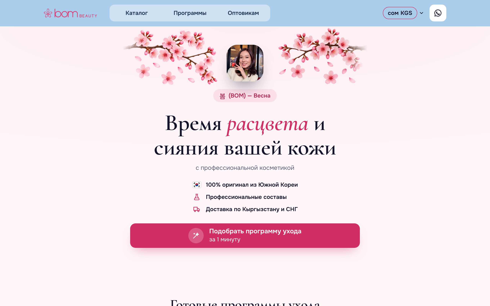
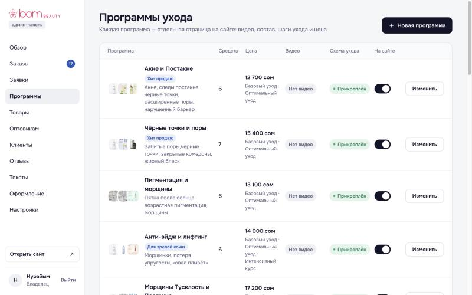
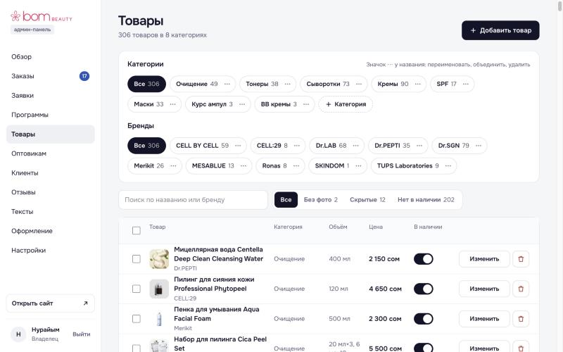

# Bom Beauty

[](https://github.com/dastan0017/bom-beauty/actions/workflows/ci.yml)
[](https://github.com/dastan0017/bom-beauty/actions/workflows/deploy.yml)

Online shop and owner admin for **Bom Beauty**, a Korean professional skincare shop in Kyrgyzstan.

**Live: [bom-beauty.com](https://bom-beauty.com)**

Visitors choose a ready-made care program or single products, fill a short order form and land in a prefilled WhatsApp
chat, or pay online through Finik. Every order is recorded in the admin, where the owner runs the whole shop: orders,
programs, products, texts, reviews, colours and currencies.

## Screenshots

### Website

Mobile-first client site in Russian, with prices in сом or the visitor's currency.

<table>
  <tr>
    <th>Home page, desktop</th>
    <th>Catalog, phone</th>
  </tr>
  <tr>
    <td valign="top"></td>
    <td valign="top" width="260"></td>
  </tr>
</table>

### Admin

Owner-only panel at `admin.bom-beauty.com`: a sidebar on desktop, scrolling tabs on phones.

<table>
  <tr>
    <th>Care programs with their variants and prices</th>
    <th>Products with category and brand filters</th>
  </tr>
  <tr>
    <td valign="top"></td>
    <td valign="top"></td>
  </tr>
</table>

Screenshots are from production (November 2026). Admin screens with customer data (orders, leads, customers) are left
out on purpose.

## Features

**Website** ([bom-beauty.com](https://bom-beauty.com))

- Care programs with variants (Базовый уход, Оптимальный уход, Интенсивный курс), each with its own price and the
  crossed-out price of the products bought separately; a video from the owner and a care scheme PDF per program.
- Catalog with filters by problem, product type and brand, and a search that reads typos, the other keyboard layout,
  Latin or Cyrillic spellings and everyday words («прыщи» finds acne care).
- Cart and a short order form that opens a prefilled WhatsApp chat, or online payment through Finik.
- A 4-question quiz that recommends programs, a wholesale page, reviews, currency switcher.
- Server-rendered pages that work without JavaScript, with SEO metadata and structured data.

**Admin**

- Orders with statuses, bulk actions, notes and payment links; leads and customers.
- Programs and products editors: photos, videos (Bunny Stream), PDFs, variants, related products, stock and publishing.
- Site texts, reviews, quiz lists, theme colours, currencies and payment settings, all without a developer.
- Audit log of every change.

## Stack

| Part      | Technology                                                                                  |
| --------- | ------------------------------------------------------------------------------------------- |
| Website   | Next.js 16 (App Router, Server Components, ISR), React 19, Tailwind CSS 4                   |
| Admin     | Vite 8, React 19, TanStack Query, shadcn/ui restyled to the design                          |
| API       | NestJS 11, Prisma 7, PostgreSQL 16, BullMQ worker on Redis 7, OpenAPI                       |
| Shared    | `packages/shared`: zod schemas, labels, money and currency, theme, quiz, WhatsApp texts     |
| Hosting   | Hetzner VPS with Docker Compose and Caddy, Cloudflare, Hetzner Object Storage, Bunny Stream |
| Payments  | Finik (hosted payment page and signed webhooks)                                             |
| Analytics | Umami (self-hosted)                                                                         |
| Tests     | Vitest (unit and API integration), Playwright (site and admin flows)                        |

## Production

| Host                                                    | What                        |
| ------------------------------------------------------- | --------------------------- |
| [bom-beauty.com](https://bom-beauty.com)                | client website              |
| `admin.bom-beauty.com`                                  | admin panel (owner sign-in) |
| [api.bom-beauty.com](https://api.bom-beauty.com/health) | API, routes under `/v1`     |
| `media.bom-beauty.com`                                  | processed images and PDFs   |

A push to `main` runs [CI](.github/workflows/ci.yml) (lint, type checks, tests); when it passes,
[Deploy](.github/workflows/deploy.yml) builds the images, backs up the database when migrations are pending, migrates,
restarts the services and runs health checks. [Ops](.github/workflows/ops.yml) runs server tasks (status, backups,
restore drill) without SSH. Setup and operations: [docs/DEPLOY.md](docs/DEPLOY.md).

## Repository layout

```
frontend/          Next.js client site
backend/           NestJS API, BullMQ worker (--worker), Prisma schema and migrations, CLI
admin/             Vite + React admin SPA
packages/shared/   zod schemas, enums, labels, money and currency, theme engine, quiz, WhatsApp texts, API client
packages/config/   tsconfig bases, ESLint, Prettier, design tokens, fonts
infra/             Docker Compose files, Caddyfile, .env.example, backup scripts
design/            exported design files, the source of truth for the UI
docs/              architecture, data model, API, deploy, milestones, handoff
```

## Quick start

Requirements: Node 24 (`.tool-versions` / `.nvmrc`), Docker, pnpm via corepack (`corepack enable pnpm`).

```sh
pnpm install
pnpm dev          # creates .env from infra/.env.example, starts Docker services and all apps
pnpm db:migrate   # first run, in a second terminal: create the tables
pnpm db:seed      # demo catalog, programs and the owner account from SEED_OWNER_* in .env
```

| URL                          | What                                                |
| ---------------------------- | --------------------------------------------------- |
| http://localhost:3100        | client site                                         |
| http://localhost:5173        | admin                                               |
| http://localhost:4000/health | API (routes under `/v1`, Swagger UI at `/docs`)     |
| http://localhost:9000        | S3 (SeaweedFS), buckets `bom-public`, `bom-private` |
| http://localhost:8025        | Mailpit (outgoing mail)                             |

Postgres listens on `localhost:5434`, Redis on `6379`. Sign in to the admin with `SEED_OWNER_EMAIL` and
`SEED_OWNER_PASSWORD` from `.env`, or create another account with `pnpm --filter @bom/backend cli create-admin`.

## Commands

| Command                            | What it does                                                              |
| ---------------------------------- | ------------------------------------------------------------------------- |
| `pnpm dev`                         | Docker services and all apps with the worker                              |
| `pnpm lint` / `typecheck` / `test` | the whole repo through Turborepo                                          |
| `pnpm e2e`                         | Playwright flows of the site and the admin (needs `pnpm dev`)             |
| `pnpm db:migrate` / `db:seed`      | Prisma migrate dev / idempotent seed                                      |
| `pnpm gen:api`                     | regenerate `backend/openapi.json` and the shared API types                |
| `pnpm --filter <pkg> <script>`     | one package: `@bom/frontend`, `@bom/backend`, `@bom/admin`, `@bom/shared` |

The end-to-end flows create real orders and leads in the dev database. Before the first run, install the browser with
`pnpm --filter @bom/frontend exec playwright install chromium`.

## Docs

- [CLAUDE.md](CLAUDE.md): conventions and working rules
- [docs/ARCHITECTURE.md](docs/ARCHITECTURE.md): system, flows and decisions
- [docs/DATA-MODEL.md](docs/DATA-MODEL.md): database schema
- [docs/API.md](docs/API.md): endpoints
- [docs/DEPLOY.md](docs/DEPLOY.md): production setup and operations
- [docs/TASKS.md](docs/TASKS.md): milestones
- [docs/HANDOFF.md](docs/HANDOFF.md): what the owner provides (in Russian)
- [docs/finik/SPEC.md](docs/finik/SPEC.md): online payment through Finik
